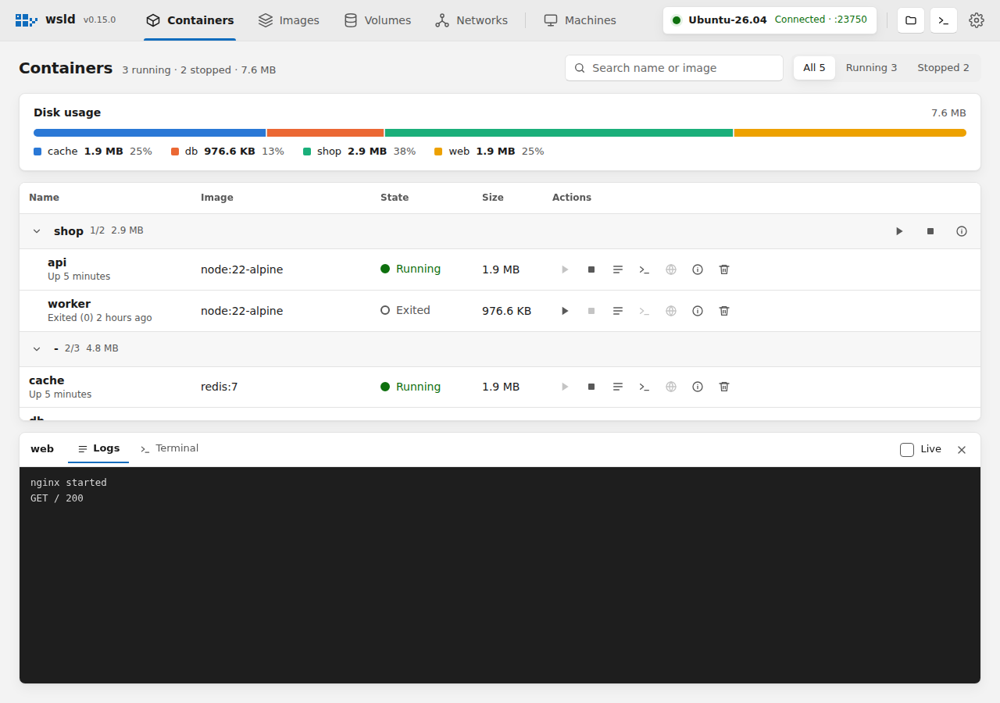
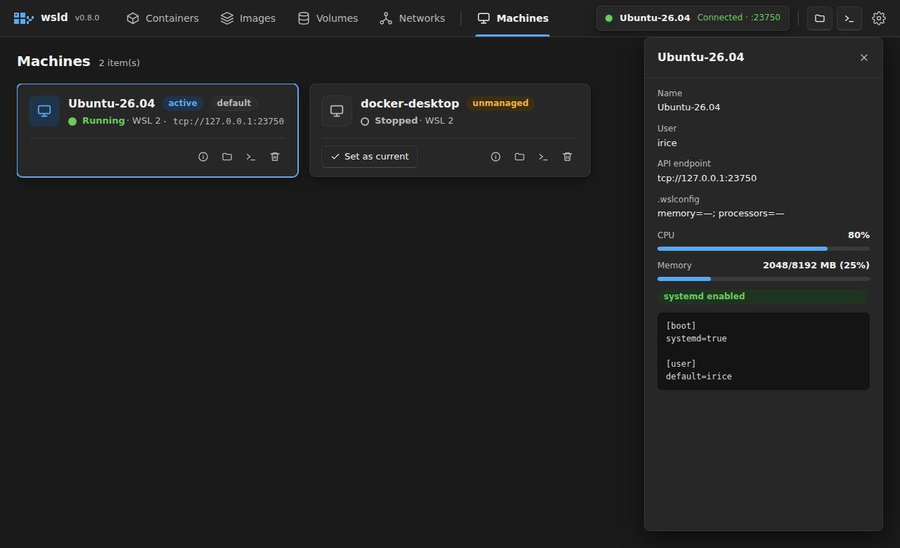
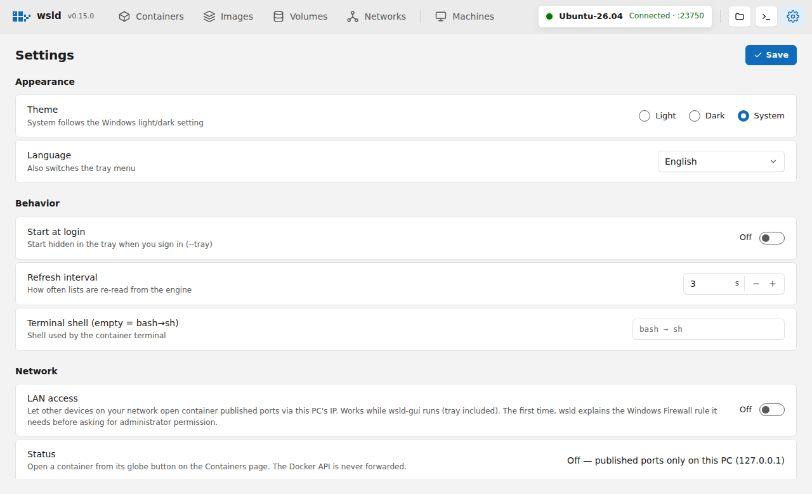

# wsld — WSL with Docker

在 Windows 上跑 Docker，但不靠 Docker Desktop。

把 WSL2 當開發機（程式放 Linux 檔系統），裡面跑 dockerd；外面用 `wsld` CLI 或 `wsld-gui` 管引擎與容器。感覺接近 mac 上的 OrbStack。

目前 **0.18.0**（tag `v0.18.0`）已交付（Kubernetes 頁重做：namespace flow card＋右側 50% 側欄，分頁 Architecture 架構圖／Pods／Workloads／Services／Config／Storage，點 Deployment 看詳情；啟動後狀態轉換修正（node 尚未 Ready 時持續輪詢，不再卡在「啟動中」）、載入並行化、namespace 卡片如實顯示裡面的內容（沒有專屬分頁的 Lease／Role／Secret／Job 等依種類計數，新增 Other 分頁；namespace 分成 Workloads／System（`kube-*` 內建）兩個頁籤，System 有異常時頁籤亮紅點；卡片以分類標籤（預設／自建／系統）取代健康徽章，只在異常時標示；沒有 Pod 的系統 namespace 直接列出內容，架構圖為空時也列出）、k3s node 改以 machine 名稱命名（新安裝；既有叢集 Reset 後套用）；0.17.2 機器卡片圖示改為各 distro 的 logo；修正：主要機器不再於閒置約 20 秒後被 WSL 自動停止；0.17.1 開啟已停止機器的 Info 不再把它啟動；0.17.0 機器磁碟上限：新增機器時可指定虛擬磁碟上限（預設 60 GB，取代 WSL 預設的 1 TB），既有機器可在 Info 或以 `wsld resize-disk` 調整）：見 [ROADMAP](docs/ROADMAP.md)、[SPEC](docs/SPEC.md)。Phase 0–4 基底可用；之後 v2.0 會換成 WinUI。

```text
Windows                         WSL2
┌─────────────────────┐         ┌──────────────────┐
│  wsld-gui / wsld    │  TCP    │  你的專案        │
│                     │────────►│  dockerd         │
└─────────────────────┘         │  :23750+         │
                                └──────────────────┘
```

## 畫面



<p>
  
  
</p>

<sub>以 `wsld-gui-testhost`（假後端）截圖；`make readme-shots` 可重新產生。</sub>

## 快速開始

### 前置

- Windows 11 x64；第一次裝 WSL 需要管理員權限
- 還沒裝 WSL 的話，開**管理員** PowerShell：

```powershell
.\scripts\01-enable-wsl.ps1   # 開 WSL2 + Ubuntu；可能要重開機
```

- 執行檔：Release 下載，或自己 `make build-win`（產出在 `dist/`）

### 初始化（做一次）

```powershell
wsld init
```

會選／裝 Ubuntu、在裡面裝 Docker、開 systemd、把 API 綁在 `127.0.0.1:23750`（被占用就換埠），並寫入 `%APPDATA%\wsld\config.toml`。

### CLI

```powershell
wsld start                 # 喚醒 distro、起 dockerd
wsld use <distro>          # 設為主要；首次會自動 init + start
wsld unmanage <distro>     # 停 docker 並刪 profile（保留 WSL）
wsld unregister <d> --confirm <d>
wsld resize-disk <d> 60     # 調整磁碟上限（GB；需要關閉 WSL 時會說明，確認後加 --shutdown）
wsld compact-disk <d>       # 把不再使用的磁碟空間還給 Windows（同上，可能需要 --shutdown）
wsld status                # 0 就緒／3 未就緒／4 API 掛了
wsld ps [-a] [--json]
wsld logs <ct> [--tail 100] [--follow]
wsld stop-ct <ct> / wsld start-ct <ct>
wsld exec <ct> [cmd…]
wsld doctor                # 健康檢查 + 建議
wsld lan on|off|status     # 區網存取（wsld-gui 在內網 IP 轉發容器埠）
wsld k8s on|off|status     # 選用的單節點 k3s（與 docker 共用映像檔；reset／kubeconfig／uninstall 見 OPERATIONS）
```

也可以直接用一般 `docker`：

```powershell
$env:DOCKER_HOST = "tcp://127.0.0.1:23750"   # Windows
```

```bash
export DOCKER_HOST=tcp://127.0.0.1:23750     # WSL（或重開終端後走 unix socket）
cd ~/Projects/myapp && docker run -v "$PWD:/app" …
```

### GUI

```powershell
wsld-gui.exe           # 開主視窗；按 X 縮到系統匣
wsld-gui.exe --tray    # 只留系統匣
```

側欄切 Containers／Images／Volumes／Networks／Machines／Kubernetes／Settings；標題列可開資料夾、終端、啟動引擎。細節：[GUI](docs/GUI.md)。

### 重開機之後

再跑一次 `wsld start`，或在 GUI 按「啟動引擎」。並存 Desktop、踩坑：[OPERATIONS](docs/OPERATIONS.md)。

## 小提醒

1. 程式碼放 WSL `$HOME`，別把 `C:\` 當主戰場。
2. 用 WSL Remote 開發比較順。
3. 盡量別跟 Docker Desktop 雙引擎混著玩。
4. API 預設 **23750**（占用會換），只聽 `127.0.0.1`。
5. 要讓手機／其他電腦連到容器（`http://<內網IP>:8080`）：到 GUI Settings › 網路開啟「區網存取」，或執行 `wsld lan on`。wsld-gui 會在內網 IP 轉發容器的 published 埠。第一次開啟時若 wsld-gui 尚未通過 Windows 防火牆，wsld 會先說明要加的規則（私人＋公用網路、只接受同網段；規則綁定 exe 位置，搬移後需重新授權），按「繼續」後由 Windows 內建的 netsh 經 UAC 加入；授權前不轉發。只在 wsld-gui 執行時有效（含系統匣），API 不轉發。細節見 [OPERATIONS](docs/OPERATIONS.md#區網存取讓其他設備連到容器)。

## 開發

```bash
make test        # shellcheck + bats + Pester + go test + Playwright
make build-win   # dist/wsld.exe + dist/wsld-gui.exe（VERSION←git exact tag，預設 0.17.1；GUI 頂部列 v0.17.1）
```

GUI／CLI 共用 `internal/*`，功能先寫測試再實作。

## 文件

| 文件 | 內容 |
| --- | --- |
| [SPEC](docs/SPEC.md) | 規格（**0.17.1** 已交付） |
| [ROADMAP](docs/ROADMAP.md) | 分期 |
| [ARCHITECTURE](docs/ARCHITECTURE.md) | 架構 |
| [BOOTSTRAP](docs/BOOTSTRAP.md) | 安裝腳本細節 |
| [GUI](docs/GUI.md) | 介面說明 |
| [OPERATIONS](docs/OPERATIONS.md) | 日常使用／故障排除 |
| [TESTING](docs/TESTING.md) | 怎麼跑測試 |
| [config.example.toml](config.example.toml) | 設定範例 |

## 授權

[MIT](LICENSE)
